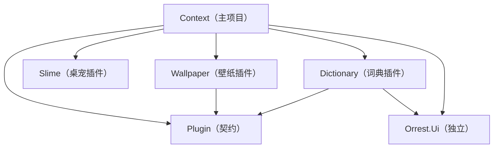

# Context 架构文档

WPF + .NET 10 桌面应用（桌宠）。MVVM 使用 CommunityToolkit.Mvvm，交互行为使用 Microsoft.Xaml.Behaviors.Wpf，依赖注入使用 Microsoft.Extensions.DependencyInjection，数据访问 Dapper + SQLite。解决方案为 slnx 格式；NuGet 版本集中在 `Directory.Packages.props` 统一管理（CPM）。

## 文档撰写规则

本文档只记录**低频变动**的内容：读它应当能理解系统骨架，而不必随功能迭代同步修订。

- **属于本文档**：单元划分与依赖方向、技术选型、目录组织、贯穿各处的通用约定（编码规则、DI 模式、视图组合方式、插件与快捷键机制）。
- **不属于本文档**：具体功能清单、单个组件/窗口的实现细节、字段与参数级细节。这些写在对应代码与 XML 注释里，与代码一同演进。
- **判别标准**：新增或修改某个功能时，若某条内容需要随之更新，该条就不应写在这里；只有单元划分、选型、目录、通用约定层面的变化才修订本文档。

## 目录结构

```
Context.slnx
├── Directory.Build.props             # 统一目标框架（仅面向 Windows）
├── Directory.Packages.props          # NuGet 版本集中管理（CPM）
├── src/
│   ├── Context/                      # 主项目（自包含单工程，Exe+WPF）
│   │   ├── Domain/                   #   领域层：实体
│   │   ├── UseCases/                 #   用例层：抽象接口
│   │   ├── Infrastructure/           #   基础设施层：SQLite / HTTP 实现
│   │   ├── Presentation/             #   表现层：ViewModel 与消息
│   │   ├── App/                      #   应用层：组合根 + 宿主服务（快捷键管理等）
│   │   │   ├── Views/                #     视图：主窗口（透明占位窗体，维持应用生命周期）、设置窗口
│   │   │   ├── Hotkey/               #     快捷键服务
│   │   │   └── DependencyInjection.cs / ThemeMapper.cs / App.xaml
│   ├── Plugin/               # 插件契约程序集（自包含：零包、零项目引用）
│   └── Plugins/
│       ├── Slime/                     # 桌宠插件（桌宠视图 + 动画资源；仅引用 Orrest.Ui）
│       ├── Dictionary/       # 词典插件（仅引用 Plugin 与 Orrest.Ui）
│       └── Wallpaper/       # 壁纸插件（仅引用 Plugin）
├── tests/
│   └── Context.Tests/                # 单元测试（xUnit + NSubstitute）
└── ui/                               # 独立组件库目录（可独立发布）
    ├── src/Orrest.Ui/                # WPF 组件与样式库（dotnet pack 可打包）
    └── tests/Orrest.Ui.Tests/        # 组件库自己的测试
```

## 依赖关系



### 依赖规则（单向，禁止反向）

1. **主项目自包含**：`Context` 为单工程，内部按 Clean Architecture 分层——Domain / UseCases / Infrastructure / Presentation / App 文件夹与同名命名空间；单向依赖：UseCases → Domain；Infrastructure / Presentation → UseCases；App → 全部。分层由程序集边界降级为**命名空间约定**（编译器不再强制），依靠本规则与评审/测试守护。
2. **契约程序集自包含**：`Plugin` 零 NuGet 包、零项目引用，承载插件对外声明契约（`HotkeyCommandAttribute` / `ICommandProvider` / `CommandDeclaration` / `IHotkeyCommandCatalog` 及目录聚合实现）。
3. **插件库自包含**：`src/Plugins/` 下的插件库（如 Wallpaper）不引用主项目与 Orrest.Ui，仅引用 Plugin；库内同样按 实体 / 抽象 / 用例 / 基础设施实现 角色分层，对外暴露 `AddXxx()` 装配扩展与命令声明。
4. **依赖抽象而非实现**：接口定义在 UseCases（主项目）或库内 Abstractions（插件），实现在 Infrastructure，运行期由 DI 注入；替换技术实现只改 Infrastructure。
5. **组合根唯一例外**：主项目 App 层是唯一引用插件库并完成装配的地方。
6. **ui/ 独立**：Orrest.Ui 不引用解决方案内任何项目；主项目与插件库可**单向**引用它（插件含 WPF 视图时需要其控件库）。

## 各单元职责

| 单元 | 职责 |
|---|---|
| Context/Domain | 业务模型与概念，零依赖。 |
| Context/UseCases | 用例编排；定义仓储与外部能力的抽象接口，不关心实现技术。 |
| Context/Infrastructure | 实现抽象，隔离一切技术细节（SQLite、Win32 等；各插件的 HTTP 实现随插件自包含）。 |
| Context/Presentation | ViewModel 与跨模块消息；不引用 WPF 类型，保持可单元测试。 |
| Context/App | XAML 视图 + 组合根 + 宿主服务（快捷键管理等）：组装容器、注册视图、启动与退出清理。 |
| Plugin | 插件声明契约与命令目录（反射聚合各插件经 `[HotkeyCommand]` 声明的命令）。 |
| Plugins/Slime | 桌宠功能插件库：桌宠视图与动画资源，由宿主主窗口承载（托盘、拖动等窗口行为在宿主），自包含切片。 |
| Plugins/Wallpaper | 壁纸功能插件库：必应壁纸获取与设桌面，自包含切片。 |
| Plugins/Dictionary | 词典功能插件库：金山词霸查词 + 词典窗口，自包含切片。 |
| Orrest.Ui | 独立组件与样式库（OWindow、Tray、SpriteSheetView、主题化控件、HotkeyBox）；对外资源统一由 `Themes/Generic.xaml` 暴露（使用方只需合并该字典，App 与运行时主题切换互不感知库内文件布局）。 |

## 运行时装配（App.OnStartup）

DI 扩展链式注册：`AddPresentation()` / `AddInfrastructure()` / `AddWindows()` / `AddHotkeys()` / 各插件库（`AddSlime()` / `AddDictionary()` / `AddWallpaper()` 等） → `BuildServiceProvider()` → 建库 → 应用已存主题 → 主窗口显示（其构造中依据命令目录与持久化绑定装配应用内快捷键）；`OnExit` 释放容器。跨库装配一律放在组合根。主窗口是宿主提供的透明占位窗体（维持应用生命周期），其内容由桌宠插件提供（构造注入 `SlimeView`），窗口本身不含桌宠实现。

## 编码规则

- **禁止使用 `=>` 表达式主体**实现方法、属性，实现一律使用 `{ }` 语句块。接口成员声明与 lambda 表达式不受此限。
- **可观察属性必须使用属性写法**：`[ObservableProperty]` 标注 `public partial 类型 名称 { get; set; }`（属性名即绑定名），禁止使用早期的 `[ObservableProperty] private 类型 字段;` 字段写法。
- **每个 View 必须声明自己的 `d:DataContext`**：根元素以 `d:DataContext="{d:DesignInstance Type=vm:对应ViewModel, IsDesignTimeCreatable=False}"` 给出 ViewModel 路径（DI 构造的 ViewModel 一律 `IsDesignTimeCreatable=False`），并引入 `d`/`mc` 命名空间与 `mc:Ignorable="d"`。设计器据此解析绑定，运行时 `DataContext` 仍由组合根注入。纯静态视图（无任何绑定，如 SlimeView）不受此限。

## 通用约定

- **每层提供一个 `AddXxx(this IServiceCollection)` 扩展方法**，组合根链式调用，层内注册细节不外泄；插件库同理。
- **所有 View 与 ViewModel 一律 Transient**，不使用 Singleton。子 ViewModel 不由容器直接注入父 VM（直接注入会让容器持有实例直到作用域释放），而是注入 `Func<子ViewModel>` 工厂，由父 VM 决定创建与释放时机。
- **ViewModel 初始化走 Behavior**：视图代码后置只做构造注入与设置 `DataContext`，不编写事件处理逻辑；数据初始化由 XAML 中的 `Interaction.Triggers` 把视图 `Loaded` 事件绑定到 ViewModel 的初始化命令（`InvokeCommandAction`）。代码后置仅允许纯窗口行为（拖动 `DragMove`、关闭窗口 `Close`）。
- **应用入口只有系统托盘图标**：所有窗口不进任务栏与 Alt+Tab；托盘注册由 XAML 附加的 `Orrest.Ui.Tray.TrayIconBehavior` 声明完成，其 `MenuItems` 子元素声明自定义菜单项（设置；命令由主窗口在构造中按命令 id 从命令目录接线，与快捷键共用实例；词典仅经应用内快捷键 Alt+D 打开），菜单尾部自动追加分隔线与内置「退出」。桌宠视图无右键菜单。
- **快捷键机制（应用内 KeyBinding）**：命令提供者（`ICommandProvider` 实现）在公共 ICommand 属性上以 `[HotkeyCommand(id, 显示名, 默认手势)]` 声明命令，经 DI 注册为 `ICommandProvider` 后由 Plugin 的命令目录**隐式聚合**——新插件或宿主命令注册即自动进入快捷键页，聚合代码零改动。声明方均为专用命令提供者类，同一模式：插件库（`DictionaryCommands` / `WallpaperCommands`）与宿主（`SettingsCommands`）。命令目录（`IHotkeyCommandCatalog`）经 `AddHotkeys()` 注册进容器；主窗口在构造中依据目录 + 持久化绑定（SQLite `hotkey_bindings` 表）装配自身的 `InputBindings`（主窗口是唯一常驻窗口；生效手势 = 显式绑定 ?? 声明默认，无效手势静默回退默认）；设置页「快捷键」Tab（Orrest.Ui `HotkeyBox` 按键录入）修改即存并广播 `HotkeysChangedMessage` 触发重装。
- **Win32 互操作统一使用源生成的 `[LibraryImport]`**（宿主类型声明为 `partial`，声明不带 `extern`）。
