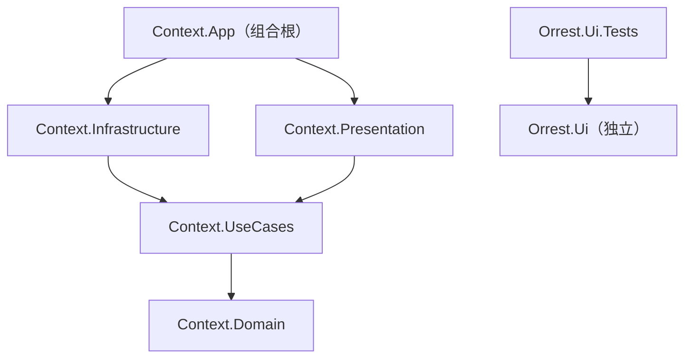

# Context 架构文档

WPF + .NET 10 桌面应用，Clean Architecture 单向分层。数据访问 Dapper + SQLite，MVVM 使用 CommunityToolkit.Mvvm，交互行为使用 Microsoft.Xaml.Behaviors.Wpf，依赖注入使用 Microsoft.Extensions.DependencyInjection。解决方案为 slnx 格式；NuGet 版本集中在 `Directory.Packages.props` 统一管理（CPM）。

## 目录结构

```
Context.slnx
├── Directory.Build.props             # 统一目标框架 net10.0-windows（仅面向 Windows）
├── Directory.Packages.props          # NuGet 版本集中管理（CPM）
├── src/
│   ├── Context.Domain/            # 领域层：实体与业务概念，零依赖
│   ├── Context.UseCases/          # 用例层：用例服务 + 抽象接口
│   ├── Context.Infrastructure/    # 基础设施层：接口的具体实现
│   ├── Context.Presentation/      # 表现层：ViewModel
│   └── Context.App/               # WPF 应用：视图 + 组合根
├── tests/
│   └── Context.Tests/             # 单元测试（xUnit + NSubstitute）
└── ui/                            # 独立组件库目录（可独立发布）
    ├── src/Orrest.Ui/             # WPF 组件与样式库（dotnet pack 可打包）；Tray/ 存放托盘相关组件
    └── tests/Orrest.Ui.Tests/     # 组件库自己的测试
```

## 依赖关系



### 依赖规则（单向，禁止反向）

1. **领域层零依赖**：Domain 不引用任何项目和包。
2. **依赖只能向下**：UseCases → Domain；Infrastructure / Presentation → UseCases。
3. **依赖抽象而非实现**：接口定义在 UseCases，实现在 Infrastructure，运行期由 DI 注入；替换技术实现只改 Infrastructure。
4. **组合根唯一例外**：`Context.App` 是唯一引用所有层的项目，负责把抽象与实现装配在一起。
5. **ui/ 完全独立**：Orrest.Ui 与各层零引用；App 需要组件时只允许 `App → Orrest.Ui`，Orrest.Ui 不得反向引用解决方案内任何项目。

## 各层职责

| 层 | 职责 |
|---|---|
| Context.Domain | 业务模型与概念。 |
| Context.UseCases | 用例编排；定义仓储与外部能力的抽象接口，不关心实现技术。 |
| Context.Infrastructure | 实现抽象，隔离一切技术细节（HTTP、Win32、SQLite 等）。 |
| Context.Presentation | ViewModel；不引用 WPF 类型，保持可单元测试。 |
| Context.App | XAML 视图 + 组合根：组装容器、注册视图、启动与退出清理。 |
| Orrest.Ui | 独立组件库；自定义控件默认样式放 `Themes/Generic.xaml`，命名样式放样式字典。 |

## 运行时装配（App.OnStartup）

各层 DI 扩展（`AddPresentation()` / `AddUseCases()` / `AddInfrastructure()`）链式注册 → 注册视图 → `BuildServiceProvider()` → 解析主窗口显示；`OnExit` 释放容器。

## 编码规则

- **禁止使用 `=>` 表达式主体**实现方法、属性，实现一律使用 `{ }` 语句块。接口成员声明与 lambda 表达式不受此限。
- **可观察属性必须使用属性写法**：`[ObservableProperty]` 标注 `public partial 类型 名称 { get; set; }`（属性名即绑定名），禁止使用早期的 `[ObservableProperty] private 类型 字段;` 字段写法。
- **每个 View 必须声明自己的 `d:DataContext`**：根元素以 `d:DataContext="{d:DesignInstance Type=vm:对应ViewModel, IsDesignTimeCreatable=False}"` 给出 ViewModel 路径（DI 构造的 ViewModel 一律 `IsDesignTimeCreatable=False`），并引入 `d`/`mc` 命名空间与 `mc:Ignorable="d"`。设计器据此解析绑定，运行时 `DataContext` 仍由组合根注入。

## 约定

- 每层提供一个 `AddXxx(this IServiceCollection)` 扩展方法，组合根链式调用，层内注册细节不外泄。
- **ViewModel 初始化走 Behavior**：视图代码后置只做构造注入与设置 `DataContext`，不编写事件处理逻辑；数据初始化由 XAML 中的 `Interaction.Triggers` 把视图 `Loaded` 事件绑定到 ViewModel 的初始化命令（`InvokeCommandAction`）。按需懒加载的模块可不绑定 `Loaded`（如壁纸列表在首次点击"换壁纸"时才加载）。视图代码后置除构造注入、`DataContext` 外，仅允许纯窗口行为（拖动 `DragMove`、关闭窗口 `Close`）。
- **桌宠窗口**：主窗口无边框透明（`WindowStyle=None` + `AllowsTransparency` + `Background=Transparent`）、`SizeToContent` 自适应、可拖动（`DragMove`）；交互入口为宠物区域右键菜单（壁纸/词典/退出，XAML 内联 `ContextMenu`，命令绑定 PetViewModel，退出为代码后置的纯窗口行为）。**应用入口只有系统托盘图标**（见下条）：所有窗口 `ShowInTaskbar=False`，`SourceInitialized` 时强制 `WS_EX_TOOLWINDOW` 的接线由 XAML 中附加的 `Orrest.Ui.Tray.TrayIconBehavior` 声明完成——任务栏按钮与 Alt+Tab 条目均不出现。注意 WPF 的 `ShowInTaskbar=False` 只清除 APPWINDOW 位、并不写 TOOLWINDOW 位，因此需强制设置。
- **系统托盘图标**：`Orrest.Ui.Tray` 提供两级 API。声明式封装 `TrayIconBehavior`：以 `<b:Interaction.Behaviors>` 附加到窗口即完成 Alt+Tab/任务栏隐藏、托盘图标注册与注销、双击托盘图标激活窗口、右键内置“退出”菜单（`Tooltip`/`ExitMenuHeader` 可配置）；底层管道 `TrayIconController`（通用组件，P/Invoke `Shell_NotifyIcon` 实现，纯 WPF 无 WinForms 依赖；机制参考 nullsoftware/TrayIcon 的 NotifyIcon 包装）：双击触发 `IconDoubleClicked` 事件（单击不动作）、右键弹出 `Menu` 供自定义接线；Explorer 重启（`TaskbarCreated` 广播）时自动重新注册，回调消息经 HwndSource 钩子挂载在窗口 HWND 上。`TrayIconBehavior` 依赖 `Microsoft.Xaml.Behaviors.Wpf`。互操作统一使用源生成的 `[LibraryImport]`（宿主类型声明为 `partial`，声明不带 `extern`）。
- **所有 View 与 ViewModel 一律 Transient**：容器中注册的视图与 ViewModel 统一 `AddTransient`，不使用 Singleton。子 ViewModel 不由容器直接注入到父 VM（直接注入会让容器持有实例直到作用域释放），而是注入 `Func<子ViewModel>` 工厂，由父 VM 决定创建与释放时机。
- **ViewModel-first 组合子视图**：父 View 不在 XAML 直接嵌套子 View 标签，也不注入子 View。父 VM 通过工厂创建并持有子 VM；父 View 用 `ContentControl Content="{Binding 子VM属性}"` 渲染，资源字典中以 `DataTemplate DataType="{x:Type vm:子ViewModel}"` 声明 VM→View 映射。子 View 由 XAML 无参创建，其 `DataContext` 即内容绑定提供的子 VM；可视化树掌控 View 生命周期——View 随时可丢弃、不持有状态，状态全部保存在 ViewModel 中。
- **跨模块 UI 请求用 Messenger**：模块 ViewModel 需要触发窗口级操作（如打开词典弹窗）时，不使用 .NET 事件，而是经 CommunityToolkit.Mvvm.Messenger 广播消息——VM 内 `Messenger.Send(new XxxMessage())`，消息类型定义在 `Presentation/Messages/`；接收方 View 实现 `IRecipient<T>` 并 `RegisterAll`/`UnregisterAll` 注册。`IMessenger` 由 DI 注入（单例 `WeakReferenceMessenger.Default`），测试可注入独立实例避免全局状态。
- 单元测试通过模拟 UseCases 抽象进行，不发真实网络请求、不改动系统状态。
- WPF 控件的测试需在 STA 线程执行（xUnit 默认 MTA）。
- 目标框架统一在 `Directory.Build.props` 声明为 `net10.0-windows`（本解决方案仅面向 Windows，同时使平台兼容性分析器 CA1416 不再对 Windows 专属 API 告警），各 Context 项目的 csproj 不再单独声明；必须在 props 声明——targets 阶段设置会破坏 sln 级 NuGet 还原。Orrest.Ui 的 csproj 保留同值声明，以便未来独立发布时可脱离本文件构建。
- SQLite/Dapper 为保留的基础设施骨架，当前无功能使用，供未来功能复用。

## 扩展一个新功能

Domain 实体 → UseCases 抽象接口与用例服务 → Infrastructure 实现并在 `AddInfrastructure()` 注册 → Presentation ViewModel 并在 `AddPresentation()` 注册 → App 视图 → 补充单元测试。全程保持依赖规则。
