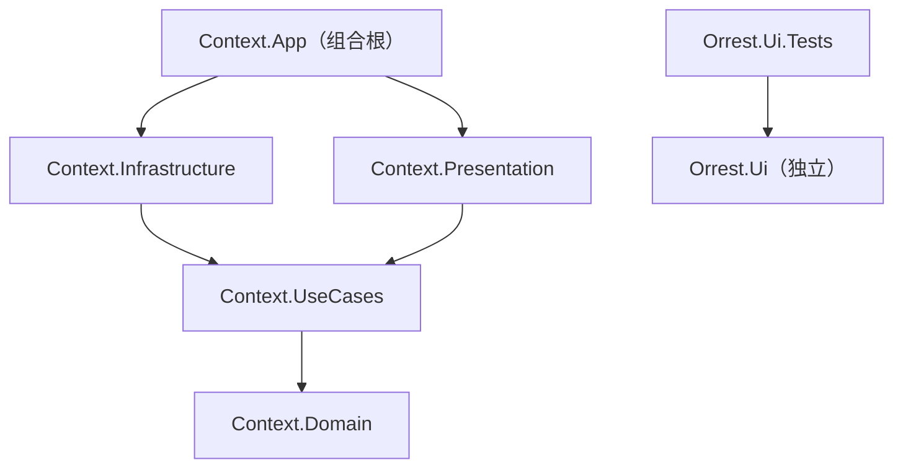

# Context 架构文档

WPF + .NET 10 桌面应用，Clean Architecture 单向分层。数据访问 Dapper + SQLite，MVVM 使用 CommunityToolkit.Mvvm，交互行为使用 Microsoft.Xaml.Behaviors.Wpf，依赖注入使用 Microsoft.Extensions.DependencyInjection。解决方案为 slnx 格式；NuGet 版本集中在 `Directory.Packages.props` 统一管理（CPM）。

## 文档撰写规则

本文档只记录**低频变动**的内容：读它应当能理解系统骨架，而不必随功能迭代同步修订。

- **属于本文档**：分层结构与依赖方向、技术选型、目录组织、贯穿各层的通用约定（编码规则、DI 模式、视图组合方式）。
- **不属于本文档**：具体功能清单、单个组件/窗口的实现细节、字段与参数级细节。这些写在对应代码与 XML 注释里，与代码一同演进。
- **判别标准**：新增或修改某个功能时，若某条内容需要随之更新，该条就不应写在这里；只有分层、选型、目录、通用约定层面的变化才修订本文档。

## 目录结构

```
Context.slnx
├── Directory.Build.props             # 统一目标框架（仅面向 Windows）
├── Directory.Packages.props          # NuGet 版本集中管理（CPM）
├── src/
│   ├── Context.Domain/            # 领域层：实体与业务概念，零依赖
│   ├── Context.UseCases/          # 用例层：用例服务 + 抽象接口
│   ├── Context.Infrastructure/    # 基础设施层：接口的具体实现
│   ├── Context.Presentation/      # 表现层：ViewModel
│   └── Context.App/               # WPF 应用：视图 + 组合根
├── tests/
│   └── Context.Tests/             # 单元测试（xUnit + NSubstitute）
└── ui/                            # 独立组件库目录（可独立发布）
    ├── src/Orrest.Ui/             # WPF 组件与样式库（dotnet pack 可打包）
    └── tests/Orrest.Ui.Tests/     # 组件库自己的测试
```

## 依赖关系



### 依赖规则（单向，禁止反向）

1. **领域层零依赖**：Domain 不引用任何项目和包。
2. **依赖只能向下**：UseCases → Domain；Infrastructure / Presentation → UseCases。
3. **依赖抽象而非实现**：接口定义在 UseCases，实现在 Infrastructure，运行期由 DI 注入；替换技术实现只改 Infrastructure。
4. **组合根唯一例外**：`Context.App` 是唯一引用所有层的项目，负责把抽象与实现装配在一起。
5. **ui/ 完全独立**：Orrest.Ui 与各层零引用；App 需要组件时只允许 `App → Orrest.Ui`，Orrest.Ui 不得反向引用解决方案内任何项目。

## 各层职责

| 层 | 职责 |
|---|---|
| Context.Domain | 业务模型与概念。 |
| Context.UseCases | 用例编排；定义仓储与外部能力的抽象接口，不关心实现技术。 |
| Context.Infrastructure | 实现抽象，隔离一切技术细节（HTTP、Win32、SQLite 等）。 |
| Context.Presentation | ViewModel；不引用 WPF 类型，保持可单元测试。 |
| Context.App | XAML 视图 + 组合根：组装容器、注册视图、启动与退出清理。 |
| Orrest.Ui | 独立组件库；自定义控件默认样式放 `Themes/Generic.xaml`，命名样式放样式字典。 |

## 运行时装配（App.OnStartup）

各层 DI 扩展（`AddPresentation()` / `AddUseCases()` / `AddInfrastructure()`）链式注册 → 注册视图 → `BuildServiceProvider()` → 解析主窗口显示；`OnExit` 释放容器。

## 编码规则

- **禁止使用 `=>` 表达式主体**实现方法、属性，实现一律使用 `{ }` 语句块。接口成员声明与 lambda 表达式不受此限。
- **可观察属性必须使用属性写法**：`[ObservableProperty]` 标注 `public partial 类型 名称 { get; set; }`（属性名即绑定名），禁止使用早期的 `[ObservableProperty] private 类型 字段;` 字段写法。
- **每个 View 必须声明自己的 `d:DataContext`**：根元素以 `d:DataContext="{d:DesignInstance Type=vm:对应ViewModel, IsDesignTimeCreatable=False}"` 给出 ViewModel 路径（DI 构造的 ViewModel 一律 `IsDesignTimeCreatable=False`），并引入 `d`/`mc` 命名空间与 `mc:Ignorable="d"`。设计器据此解析绑定，运行时 `DataContext` 仍由组合根注入。

## 通用约定

- **每层提供一个 `AddXxx(this IServiceCollection)` 扩展方法**，组合根链式调用，层内注册细节不外泄。
- **所有 View 与 ViewModel 一律 Transient**，不使用 Singleton。子 ViewModel 不由容器直接注入父 VM（直接注入会让容器持有实例直到作用域释放），而是注入 `Func<子ViewModel>` 工厂，由父 VM 决定创建与释放时机。
- **ViewModel-first 组合子视图**：父 View 不在 XAML 直接嵌套子 View 标签，也不注入子 View。父 VM 通过工厂创建并持有子 VM；父 View 用 `ContentControl Content="{Binding 子VM属性}"` 渲染，资源字典中以 `DataTemplate DataType="{x:Type vm:子ViewModel}"` 声明 VM→View 映射。子 View 可随时丢弃、不持有状态，状态全部保存在 ViewModel 中。
- **ViewModel 初始化走 Behavior**：视图代码后置只做构造注入与设置 `DataContext`，不编写事件处理逻辑；数据初始化由 XAML 中的 `Interaction.Triggers` 把视图 `Loaded` 事件绑定到 ViewModel 的初始化命令（`InvokeCommandAction`）。代码后置仅允许纯窗口行为（拖动 `DragMove`、关闭窗口 `Close`）。
- **应用入口只有系统托盘图标**：所有窗口不进任务栏与 Alt+Tab，托盘注册/注销由 XAML 中附加的 `Orrest.Ui.Tray.TrayIconBehavior` 声明完成，机制细节见该组件代码与 XML 注释。
- **Win32 互操作统一使用源生成的 `[LibraryImport]`**（宿主类型声明为 `partial`，声明不带 `extern`）。
