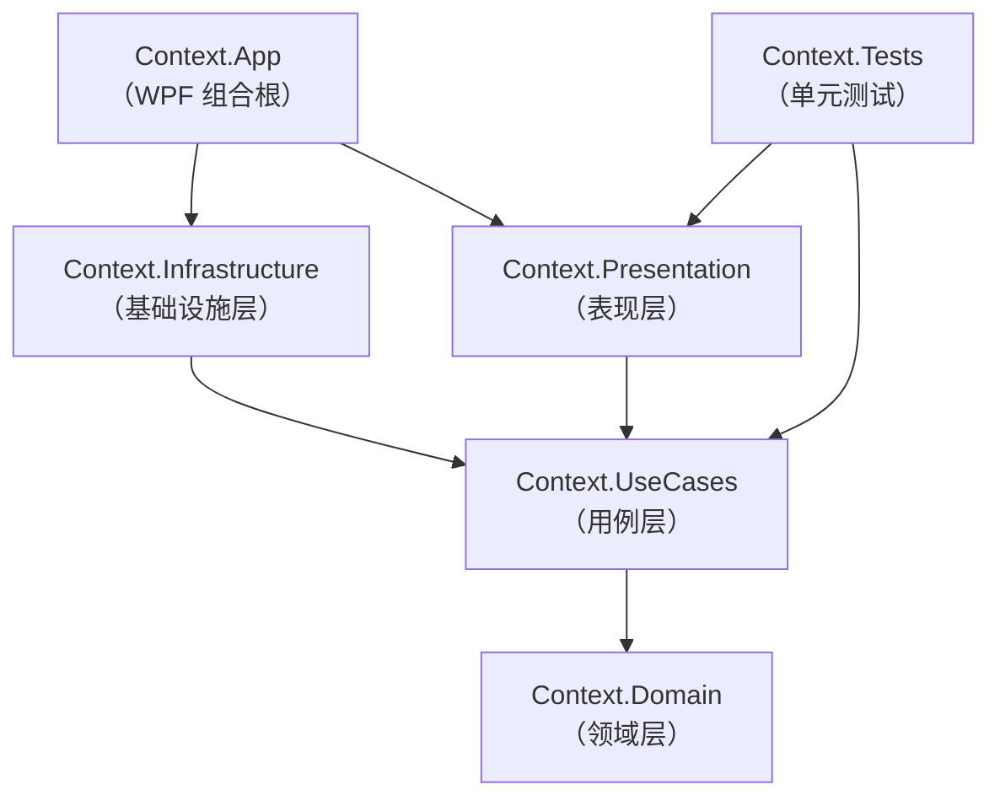

# Context 解决方案架构文档

WPF + .NET 10 桌面应用骨架，采用 Clean Architecture（整洁架构）分层，数据访问使用 Dapper + SQLite，MVVM 使用 CommunityToolkit.Mvvm，依赖注入使用 Microsoft.Extensions.DependencyInjection。

## 1. 解决方案概览

| 项 | 值 |
|---|---|
| 解决方案文件 | `Context.slnx`（新版 XML 解决方案格式） |
| 目标框架 | 类库 `net10.0`；WPF 应用 `net10.0-windows` |
| 包管理 | Central Package Management（`Directory.Packages.props` 统一管理版本） |
| 单元测试 | xUnit 2.9 + NSubstitute 5.3 |

### 包版本（统一在 Directory.Packages.props 中维护）

| 包 | 版本 | 所在项目 |
|---|---|---|
| CommunityToolkit.Mvvm | 8.4.2 | Context.Presentation |
| Dapper | 2.1.89 | Context.Infrastructure |
| Microsoft.Data.Sqlite | 10.0.12 | Context.Infrastructure |
| Microsoft.Extensions.DependencyInjection | 10.0.12 | Context.App |
| Microsoft.Extensions.DependencyInjection.Abstractions | 10.0.12 | UseCases / Infrastructure / Presentation |
| NSubstitute | 5.3.0 | Context.Tests |
| xunit / xunit.runner.visualstudio / Microsoft.NET.Test.Sdk / coverlet.collector | 见 props | Context.Tests |

## 2. 目录结构

```
Context.slnx
├── Directory.Packages.props              # NuGet 版本集中管理
├── ARCHITECTURE.md                       # 本文档
├── .gitignore
├── src/
│   ├── Context.Domain/                   # 领域层 —— 实体与业务概念
│   │   └── Entities/Product.cs
│   ├── Context.UseCases/                 # 用例层 —— 用例与抽象接口（原 Application 层）
│   │   ├── Abstractions/IProductRepository.cs
│   │   ├── Services/ProductService.cs
│   │   └── DependencyInjection.cs        # AddUseCases()
│   ├── Context.Infrastructure/           # 基础设施层 —— Dapper + SQLite 实现
│   │   ├── Persistence/IDbConnectionFactory.cs
│   │   ├── Persistence/SqliteConnectionFactory.cs
│   │   ├── Persistence/DatabaseInitializer.cs
│   │   ├── Persistence/ProductRepository.cs
│   │   └── DependencyInjection.cs        # AddInfrastructure()
│   ├── Context.Presentation/             # 表现层 —— ViewModel
│   │   ├── ViewModels/MainViewModel.cs
│   │   └── DependencyInjection.cs        # AddPresentation()
│   └── Context.App/                      # WPF 应用 —— 视图 + 组合根
│       ├── App.xaml / App.xaml.cs
│       └── MainWindow.xaml / MainWindow.xaml.cs
└── tests/
    └── Context.Tests/                    # 单元测试
        ├── ProductServiceTests.cs
        └── MainViewModelTests.cs

ui/                                       # 独立组件库目录（可独立发布，未被 App 引用）
├── src/
│   └── Orrest.Ui/                       # WPF 组件与样式库（net10.0-windows，可 dotnet pack）
│       ├── AssemblyInfo.cs               # ThemeInfo：默认样式指向本程序集
│       ├── Controls/Badge.cs             # 自定义控件（TemplatedControl）示例
│       ├── Converters/NullToCollapsedConverter.cs
│       ├── Styles/Controls.xaml          # 样式字典：Badge 默认样式 + AccentButtonStyle
│       └── Themes/Generic.xaml           # WPF 约定的默认样式入口
└── tests/
    └── Orrest.Ui.Tests/                 # 组件库自己的测试（xUnit，STA 线程处理 UI 对象）
        ├── BadgeTests.cs
        └── NullToCollapsedConverterTests.cs
```

## 3. 各项目职责

### 3.1 Context.Domain（领域层）

定义业务概念，是整个解决方案的**核心**，不依赖任何其他项目或第三方包。

- `Entities/Product.cs`：示例实体 `Product`（`Id`、`Name`）。实际开发中此处放实体、值对象、领域服务等纯业务模型。

### 3.2 Context.UseCases（用例层）

编排用例，**只定义抽象，不涉及任何具体技术实现**（不知道 Dapper、SQLite 的存在）。

- `Abstractions/IProductRepository.cs`：仓储接口——`GetAllAsync()` / `AddAsync()`。由基础设施层实现。
- `Services/ProductService.cs`：用例服务，构造函数注入 `IProductRepository`；负责业务规则（如名称 Trim、非空校验）。业务逻辑写在这里，而不是 ViewModel 或仓储里。
- `DependencyInjection.cs`：`AddUseCases(this IServiceCollection)` 扩展方法，注册本层服务。各层自带的 DI 扩展让组合根无需了解层内注册细节。

### 3.3 Context.Infrastructure（基础设施层）

实现 UseCases 层定义的抽象，**所有技术细节都隔离在这里**。

- `Persistence/IDbConnectionFactory.cs` + `SqliteConnectionFactory.cs`：连接工厂，封装 `Microsoft.Data.Sqlite` 连接的创建与打开。
- `Persistence/DatabaseInitializer.cs`：首次启动执行 `CREATE TABLE IF NOT EXISTS Products`，自动创建 `app.db` 文件。
- `Persistence/ProductRepository.cs`：用 Dapper（`QueryAsync` / `ExecuteScalarAsync`）实现 `IProductRepository`。
- `DependencyInjection.cs`：`AddInfrastructure(this IServiceCollection, string connectionString = "Data Source=app.db")`，注册连接工厂、初始化器与仓储。

### 3.4 Context.Presentation（表现层）

MVVM 中的 ViewModel 层，使用 CommunityToolkit.Mvvm 的源码生成器特性。

- `ViewModels/MainViewModel.cs`：
  - `[ObservableProperty] newProductName`：输入框绑定属性（生成 `NewProductName`）。
  - `[RelayCommand] LoadAsync / AddAsync`：生成 `LoadCommand` / `AddCommand` 供 XAML 绑定。
  - 只依赖 UseCases 层的 `ProductService`，不接触任何数据库代码。
- `DependencyInjection.cs`：`AddPresentation()`，注册 ViewModel。

### 3.5 Context.App（WPF 应用 —— 组合根）

唯一的可执行项目，包含 XAML 视图，并且是**整个解决方案唯一允许"知道"所有层**的地方（组合根模式）。

- `App.xaml.cs`：启动流程——创建 `ServiceCollection` → 依次调用 `AddPresentation()` / `AddUseCases()` / `AddInfrastructure()` → 注册视图 `MainWindow` → `BuildServiceProvider()` → 执行 `DatabaseInitializer.InitializeAsync()` 建库建表 → 从容器解析 `MainWindow` 并显示；`OnExit` 释放容器。
- `MainWindow.xaml(.cs)`：视图。构造函数注入 `MainViewModel` 并设为 `DataContext`；包含 ListBox（列表）、TextBox（新品名）、添加/刷新两个按钮，全部走命令与绑定。

### 3.6 Context.Tests（单元测试）

xUnit + NSubstitute。通过模拟 `IProductRepository` / 直接构造真实 `ProductService`，在**不碰数据库、不启动 UI** 的情况下验证用例层业务规则与 ViewModel 行为（共 6 个测试）。

### 3.7 ui/（独立组件库 —— Orrest.Ui 与 Orrest.Ui.Tests）

独立于分层架构之外的 WPF 组件与样式库，目标是**将来作为独立 NuGet 包发布**（csproj 已配置 PackageId / Version / 描述，`dotnet pack` 开箱即用）。它有自己的 `ui/src` + `ui/tests` 目录结构，当前不与解决方案内任何项目互相引用（各层不依赖它，它也不依赖各层）。

- `Controls/Badge.cs`：自定义控件（TemplatedControl）骨架示例，`Themes/Generic.xaml` 提供默认样式（`AssemblyInfo.cs` 的 `ThemeInfo` 声明是样式查找的前提）。
- `Styles/Controls.xaml`：样式字典，含 Badge 默认样式与命名样式示例 `AccentButtonStyle`（使用方 `Style="{StaticResource AccentButtonStyle}"` 引用）。
- `Converters/NullToCollapsedConverter.cs`：值转换器示例。
- `Orrest.Ui.Tests`：xUnit，含 STA 线程辅助（WPF `Control` 构造要求 STA，而 xUnit 默认 MTA）。

当 Context.App 需要使用这些组件时，在组合根添加 `Context.App → Orrest.Ui` 项目引用即可，不违反依赖规则（App 本就是允许引用一切的组合根）；但不要让 Orrest.Ui 反向引用解决方案内任何项目，以保持其独立可发布性。

## 4. 项目依赖关系

### 4.1 依赖图



### 4.2 引用矩阵（✅ = 项目引用）

| 项目 ↓ 依赖 → | Domain | UseCases | Infrastructure | Presentation | App |
|---|:-:|:-:|:-:|:-:|:-:|
| Context.Domain | — | | | | |
| Context.UseCases | ✅ | — | | | |
| Context.Infrastructure | (传递) | ✅ | — | | |
| Context.Presentation | (传递) | ✅ | — | — | |
| Context.App | (传递) | (传递) | ✅ | ✅ | — |
| Context.Tests | (传递) | ✅ | — | ✅ | — |

### 4.3 依赖规则（单向，禁止反向）

1. **领域层零依赖**：Domain 不引用任何项目和包，是最稳定的一层。
2. **依赖只能向下**：UseCases → Domain；Infrastructure / Presentation → UseCases。上层知道下层的抽象，下层永远不知道上层。
3. **依赖抽象而非实现**：UseCases 只声明 `IProductRepository`；具体 Dapper 实现在 Infrastructure，运行期由 DI 注入。把 Dapper 换成 EF Core、把 SQLite 换成 SQL Server，只需改 Infrastructure 一层。
4. **组合根唯一例外**：`Context.App` 引用 Presentation + Infrastructure（并传递 UseCases/Domain），是唯一把"抽象与实现接在一起"的地方。除此之外，任何项目不得跨层引用。
5. **UI 与数据彻底隔离**：ViewModel 与 XAML 不出现任何数据库/SQL 类型；Repository 不出现任何 UI/MVVM 类型。

## 5. 一次请求的流转（点击"添加"按钮）

```
[MainWindow.xaml] 按钮 Command="{Binding AddCommand}"
        │
        ▼
[MainViewModel.AddAsync]            (Context.Presentation)
  空白输入直接返回
        │
        ▼
[ProductService.AddAsync]           (Context.UseCases)
  Trim 名称、非空校验，new Product
        │  调用接口 IProductRepository
        ▼
[ProductRepository.AddAsync]        (Context.Infrastructure, Dapper)
  INSERT INTO Products ...; SELECT last_insert_rowid();
        │  返回带 Id 的实体
        ▼
[MainViewModel] Products.Add(product)，清空输入框
        │
        ▼
[MainWindow] ObservableCollection 变更通知 → ListBox 自动刷新
```

启动时的装配顺序（`App.OnStartup`）：注册三层服务 + 视图 `MainWindow` → 构建容器 → `DatabaseInitializer` 建库建表 → 解析 `MainWindow`（构造注入 `MainViewModel`）→ 显示窗口。

## 6. 已知设计约定

- **slnx 格式**：解决方案使用新版 XML 格式（`dotnet new sln --format slnx`），`.NET 10 SDK` 原生支持。
- **CPM**：所有 NuGet 版本只写在 `Directory.Packages.props`；各 csproj 的 `PackageReference` 不带版本号。
- **每层 DI 扩展**：`AddUseCases()` / `AddInfrastructure()` / `AddPresentation()`，组合根链式调用，层内注册细节不外泄。
- **命名即消歧**：用例层项目命名为 `Context.UseCases`（而非 `Context.Application`），避免了其命名空间与 WPF 的 `System.Windows.Application` 类型在 `Context.App` 下产生解析歧义。
- **SQLite 路径**：默认连接串 `Data Source=app.db`，数据库文件生成在运行目录（bin 下），首次启动自动建表，`*.db` 已加入 .gitignore。

## 7. 如何扩展（以新增实体 "Order" 为例）

1. **Domain**：新增 `Entities/Order.cs`。
2. **UseCases**：新增 `Abstractions/IOrderRepository.cs` 与 `Services/OrderService.cs`（业务规则写在 Service）；如需在 `AddUseCases()` 注册则补充。
3. **Infrastructure**：新增 `Persistence/OrderRepository.cs`（Dapper 实现）；`DatabaseInitializer` 补建表语句；`AddInfrastructure()` 注册 `IOrderRepository → OrderRepository`。
4. **Presentation**：新增 `ViewModels/OrderViewModel.cs`；`AddPresentation()` 注册。
5. **App**：新增 `OrderWindow.xaml(.cs)`（构造注入 ViewModel），在需要的地方从容器解析显示。
6. **Tests**：为新的 Service / ViewModel 添加测试类（NSubstitute 模拟仓储接口）。

全程保持第 4.3 节的依赖规则不变。
